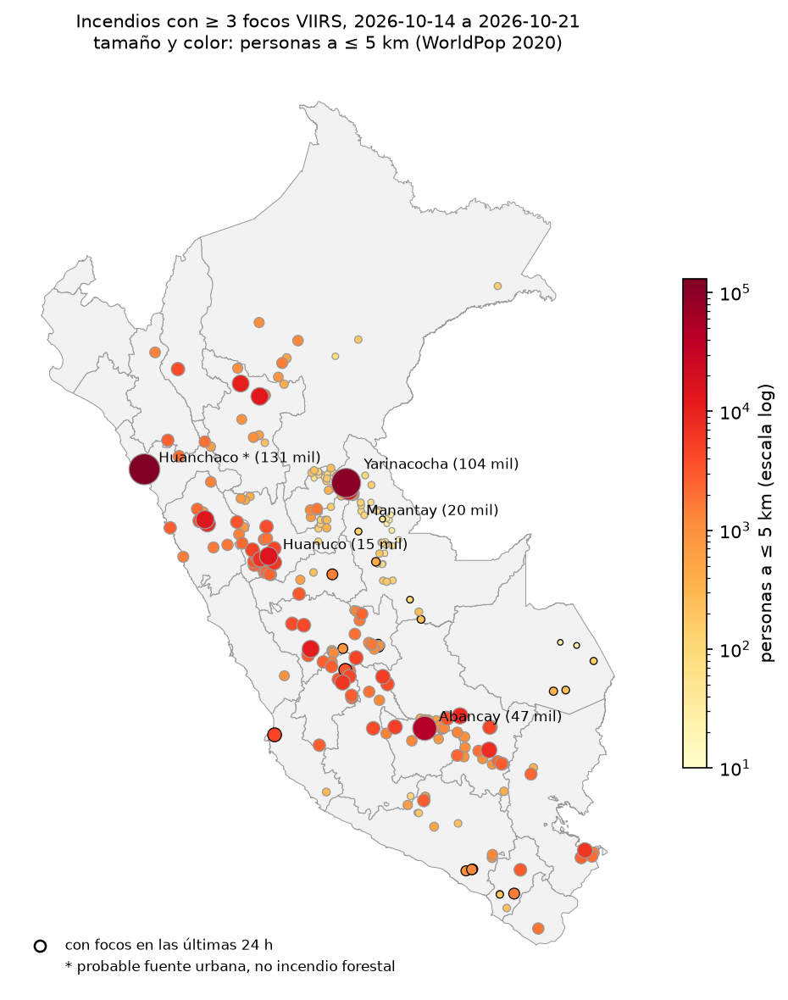
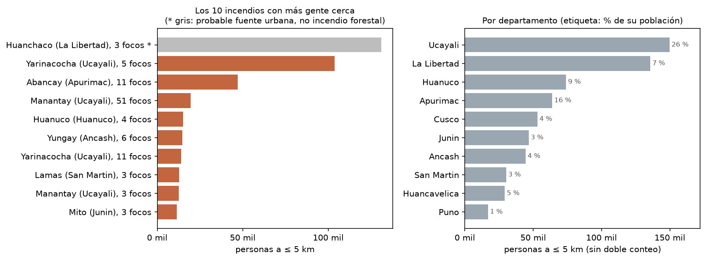
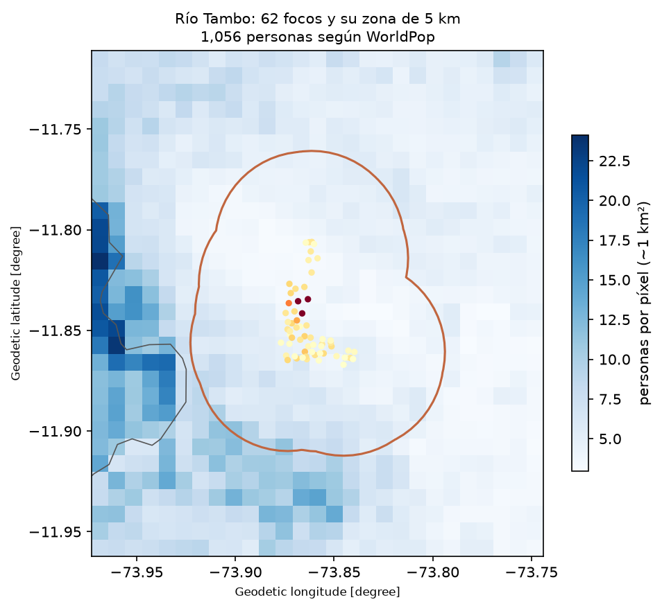
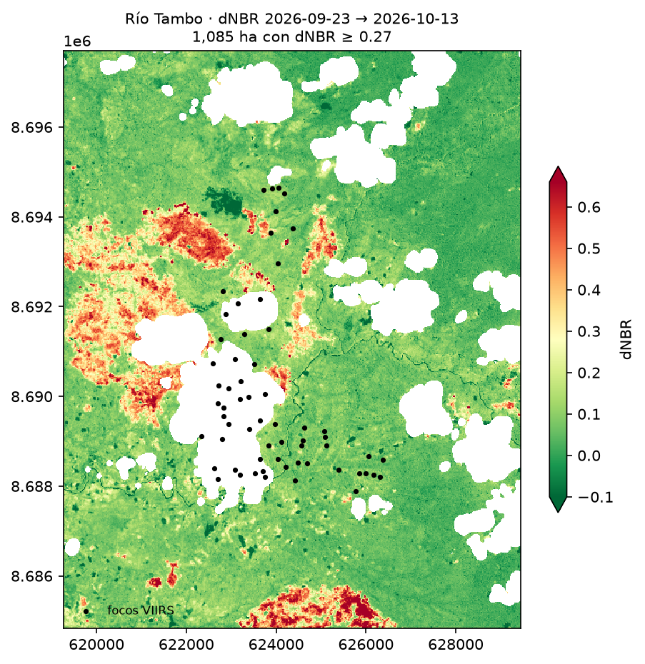

# ¿A quién afectan los incendios del Perú?

Reto D · Ciencia de Datos con Python · Universidad del Pacífico · octubre 2026

## Pregunta

¿Cuántas personas viven a 5 km o menos de los incendios activos del Perú, en qué
departamentos y cerca de qué incendios? Caso de estudio: Río Tambo (Satipo, Junín), con
su área quemada medida por satélite.

## Datos y fechas

| Fuente | Qué es | Fechas |
|---|---|---|
| NASA FIRMS, VIIRS S-NPP «South America 7d» | Focos de calor (píxeles de 375 m) | 14 al 21 de octubre de 2026 (`resultados/focos_peru.csv`) |
| WorldPop 2020, 1 km, ajustado a la ONU | Personas por píxel de ~1 km² | 2020 |
| Límites distritales del INEI con UBIGEO | 1 874 distritos (`data/distritos_peru.geojson`) | — |
| Sentinel-2 L2A, Microsoft Planetary Computer | Bandas B08, B12 y máscara SCL, a 20 m | 23 sep 2026 (0 % de nubes) y 13 oct 2026 (19 % de nubes) |

## Método

1. **Focos → incendios.** Se descartan los focos de confianza baja. Dos focos a ≤ 1 km y
   ≤ 48 h pertenecen al mismo incendio (componentes conectados con *union-find*). Solo se
   cuentan los grupos de ≥ 3 focos. "Activo" = con algún foco en las últimas 24 h.
2. **Exposición.** Buffer de 5 km alrededor de los focos de cada incendio (en UTM 18S) y
   `zonal_stats` (suma) sobre WorldPop. Para los totales se unen los círculos antes de
   sumar, así nadie se cuenta dos veces. Se reporta el rango `all_touched` False/True.
3. **Validar antes de creer.** Se revisan los incendios con más gente cerca y se marca
   el que no es un incendio de vegetación (`posible_fuente_urbana`).
4. **Río Tambo.** NBR = (B08 − B12) / (B08 + B12); dNBR = NBR antes − NBR después, con
   nubes y sombras enmascaradas por SCL. Quemado = dNBR ≥ 0,27 (clases USGS).

Todo está en [`01_ubicar_incendio.ipynb`](01_ubicar_incendio.ipynb).

## Hallazgos

1. **Exposición nacional:** entre el 14 y el 21 de octubre hubo **255 incendios** con ≥ 3
   focos; **~696 000 personas** viven a ≤ 5 km de alguno, y **~17 000** de los 21
   incendios que seguían activos en las últimas 24 h.
2. **Dónde:** **Ucayali** concentra **~150 000** personas expuestas, el **26 %** de su
   población (el mayor porcentaje del país; le sigue Apurímac con 16 %). El primer lugar
   por incendio, **Huanchaco** (La Libertad, 131 000 personas), resultó ser 3 focos de una
   sola pasada nocturna en el desierto junto a Trujillo: probablemente una fuente urbana o
   industrial, no un incendio forestal. Sin él, el total nacional baja a **~565 000**. El
   primero que sí parece quema de vegetación es **Yarinacocha**, junto a Pucallpa
   (**~104 000** personas).
3. **Río Tambo:** fue el segundo incendio con más focos del país (**62**, del 14 al 16
   oct), con **~1 085 ha** quemadas (dNBR ≥ 0,27, 23 sep → 13 oct), cerca de las ~1 000
   ha que reportan Defensa Civil y SERFOR. Pero según WorldPop solo **~1 060 personas**
   viven a ≤ 5 km (1 280 con `all_touched=True`). **El incendio más grande no es el que
   tiene más gente cerca**, y WorldPop probablemente no ve bien a las comunidades
   asháninkas dispersas que el incendio sí afectó.

## Mapas









## Decisiones y sensibilidad

Cada fila cambia una sola decisión respecto del caso base (`resultados/sensibilidad.csv`).

| Decisión | Valor | Incendios | Personas expuestas (sin doble conteo) |
|---|---|---|---|
| `RADIO_M` | 2 km | 255 | 107 075 |
| **Base** | **5 km, ≥ 3 focos** | **255** | **695 812** |
| `RADIO_M` | 10 km | 255 | 2 877 188 |
| `MIN_FOCOS` | 1 | 1 394 | 5 289 916 |
| `MIN_FOCOS` | 5 | 114 | 344 510 |

| Umbral dNBR (Río Tambo) | 0,10 | **0,27** | 0,44 |
|---|---|---|---|
| Hectáreas quemadas | 3 440 | **1 085** | 474 |

El radio es la decisión que más pesa: pasar de 2 a 10 km multiplica por 27 las personas
expuestas. Contar cualquier foco suelto como incendio (≥ 1) lo multiplica por 7,6.

## Limitaciones

- Un foco de calor no es un incendio; agrupar con 1 km / 48 h / ≥ 3 focos es una decisión.
  Huanchaco muestra que también hay fuentes de calor urbanas o industriales.
- Vivir a ≤ 5 km es **exposición**, no afectación (humo, pérdida de cultivos, evacuación).
- WorldPop 2020 es un modelo a 1 km: en la Amazonía subestima a las comunidades dispersas.
- El archivo de FIRMS solo cubre 7 días: incendios que empezaron antes (Río Tambo, 4 oct)
  aparecen incompletos.
- Las nubes esconden el fuego: VIIRS no ve bajo nubes ni bajo dosel cerrado. En la imagen
  Sentinel-2 del 13 oct, el 19 % de la zona tiene nubes y tapa el 44 % de los focos de Río
  Tambo. Además, esa imagen es anterior a los focos: las hectáreas son un mínimo.
- Las hectáreas se miden en un recuadro alrededor de los focos (+3 km); hay quemado que
  sigue fuera del borde sur.

## Cómo correrlo

Requiere [uv](https://docs.astral.sh/uv/) (o Python 3.11+ con pip).

```bash
git clone <url-de-este-repo>
cd python-intermedio-tareas/tarea_clases
uv sync                      # instala las versiones exactas de uv.lock
```

Sin uv: `pip install -r requirements.txt`.

Abre `01_ubicar_incendio.ipynb` en VS Code o Jupyter, elige el kernel `.venv` y corre
todas las celdas en orden. Luego `uv run python dashboard/construir.py` actualiza el
dashboard.

El notebook descarga lo demás de fuentes públicas que no piden clave: WorldPop y las
imágenes de Sentinel-2 de Planetary Computer. Los focos de FIRMS ya vienen congelados en
`resultados/focos_peru.csv`, para obtener los mismos números; con `DESCARGAR = True` se
bajan los de los últimos 7 días. La base de distritos (`data/distritos_peru.geojson`)
viene en el repositorio; el resto de `data/` son descargas y está en `.gitignore`.

## Dashboard

[`dashboard/index.html`](dashboard/index.html) cuenta el hallazgo en una sola página:
cifras, ranking de incendios y departamentos, mapa interactivo, el caso de Río Tambo
(dNBR, línea de tiempo y umbrales), la sensibilidad y las limitaciones. Se abre en
cualquier navegador y solo usa lo que el notebook guarda en `resultados/` y `figs/`.

Después de correr el notebook, se regenera con:

```bash
uv run python dashboard/construir.py
```

## Estructura

```
01_ubicar_incendio.ipynb   todo el análisis
dashboard/                 plantilla.html + construir.py → index.html
figs/                      mapas y gráficos de este README
resultados/                focos usados, incendios, departamentos, resumen,
                           sensibilidad y Río Tambo (CSV)
data/                      base de distritos (se sube) y descargas (no se suben)
```
